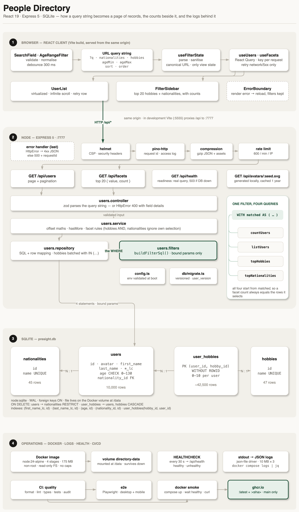

# People Directory

A searchable, filterable directory of 10,000 people. Type a name, narrow by nationality and hobbies,
and the sidebar always shows the top 20 of each **for the result set you are looking at**, with
counts that match what selecting them returns.

Built against the brief in [REQUIREMENTS.md](REQUIREMENTS.md). Live at
**[presight-one.vercel.app](https://presight-one.vercel.app)**.

- **React 19** client: URL-synced state, virtualized infinite list, validated search, light/dark
- **Express 5** API: layered routes → controller → service → repository, zod at the boundary
- **SQLite** through Node's built-in `node:sqlite`: versioned migrations, constraints, indexes
- **Production concerns**: structured JSON logs with request ids, readiness health check,
  security headers, rate limiting, compression, graceful shutdown, hardened Docker image
- **Quality gate**: CI runs format, lint, types, 136 unit/integration tests, 20 end-to-end tests,
  a dependency audit and a container smoke test on every push

---

## Quick start

### Docker (nothing else to install)

```bash
docker compose up --build
```

Open **http://localhost:7777**. The container migrates and seeds its database on first boot and
reuses it afterwards. It is ready when `docker compose ps` shows `(healthy)`.

### Node

Needs **Node 22.5+** (`.nvmrc` pins 24.15.0) for the built-in `node:sqlite` module.

```bash
nvm use
npm install
npm run seed     # creates server/data/presight.db (10,000 users, ~150ms)
npm run dev      # API on :7777, then the client on :5555
```

Open **http://localhost:5555**. `npm run dev` starts the API first and starts Vite only once
`/api/health` answers, so the first page load never races a server that is still booting. Vite
proxies `/api` to the API, so the browser always talks to one origin.

On an older Node the server exits with an explanation instead of a stack trace.

---

## Commands

| Command                  | What it does                                                             |
| ------------------------ | ------------------------------------------------------------------------ |
| `npm run dev`            | API (watch mode) + client (HMR)                                          |
| `npm run seed`           | Drop, migrate and re-seed the database (deterministic)                   |
| `npm run migrate`        | Apply pending migrations only                                            |
| `npm run build`          | Build client (Vite) and server (tsc)                                     |
| `npm start`              | Production server: API + built client on :7777                           |
| `npm test`               | Server (node:test) and client (Vitest) unit + integration tests          |
| `npm run test:coverage`  | Same, with coverage (server fails under 85% lines)                       |
| `npm run test:e2e`       | Build, then Playwright against the production server (desktop + mobile)  |
| `npm run lint`           | ESLint (TypeScript + React hooks rules)                                  |
| `npm run typecheck`      | `tsc` for both workspaces                                                |
| `npm run verify`         | format check + lint + typecheck + tests: what CI's first job runs        |
| `npm run smoke -- <url>` | Check a running instance (local, Docker or live); exits 1 on any failure |

---

## Architecture



Source: [docs/architecture.drawio](docs/architecture.drawio) (open it in draw.io / diagrams.net).

```
browser ─HTTP─▶ helmet ─▶ request log ─▶ compression ─▶ rate limit ─▶ controller ─▶ service ─▶ repository ─▶ SQLite
                (headers)  (request id)                               (zod)                    (SQL)
```

| Layer      | File                        | Knows about                      | Does not know about |
| ---------- | --------------------------- | -------------------------------- | ------------------- |
| Route      | `users/users.routes.ts`     | URL → handler                    | anything else       |
| Controller | `users/users.controller.ts` | `req`/`res`, zod schemas         | SQL                 |
| Service    | `users/users.service.ts`    | business rules (facet semantics) | HTTP, SQL           |
| Repository | `users/users.repository.ts` | SQL, row → object mapping        | HTTP, validation    |
| Filters    | `users/users.filters.ts`    | the one `WHERE` clause           | everything else     |

`buildFilterSql()` is the only place that defines which users are "in scope". It returns one
`WITH matched AS (…)` CTE that the count, the page and both facet queries all start from, so a
facet count can never disagree with the list it produces.

```
client/src
├── api/          fetch layer, ApiError, React Query client (retry policy)
├── hooks/        useFilterState (URL ⇄ state), useDirectory (queries), useTheme
├── lib/          search validation and normalisation, mirrored from the server
└── components/   UserList (virtualized), UserCard, FilterSidebar, SearchField…

server/src
├── index.ts      entry: serve · seed · seed-if-empty · seal · migrate
├── config.ts     environment, validated at boot
├── db/           connection, versioned migrations, seed, seal
├── health/       GET /api/health (readiness)
├── avatars/      GET /api/avatars/:seed.svg (generated locally)
├── shared/       logger, request logger, HttpError, error middleware
└── users/        routes → controller → service → repository → filters

e2e/              Playwright specs
api/index.mjs     Vercel entry: exports the same Express app
```

---

## Design notes

- **No `AbortSignal` in the query functions.** When a React Query function reads the signal, the
  request is aborted as soon as the query loses its observers, and StrictMode's development
  double mount does exactly that, so every page load showed aborted `/api/users` and
  `/api/facets` requests. The queries take milliseconds, so cancelling them saves nothing;
  responses are stored per query key, so a late response can never overwrite a newer one.
- **The URL is the only view state.** It is parsed leniently into a state that is always valid
  (unknown sort → default, lists capped, search normalised) and rewritten to its canonical form,
  so a hand-edited link shows the right page instead of an error.
- **One search normalisation rule on both sides**: NFC, zero-width characters removed, every run
  of whitespace collapsed, trimmed. The client applies it before writing the URL; the server
  applies it again because it must not trust the client. A contract test imports the server's
  rules into the client test run and fails if the two drift apart.
- **Errors are scoped to what failed**: a failed first page shows the error state; a failed next
  page keeps the loaded rows and offers a retry; failed facets stay in the sidebar. Only network
  errors and 5xx are retried.
- **Avatars and the font are served from this origin**, so the page makes no third-party
  requests and the Content-Security-Policy allows only `'self'`.
- **The rate limiter is attached per route** (`/api/users`, `/api/facets`), not to the router:
  router-level middleware would also count avatar requests.
- **`node:sqlite` is synchronous.** A query runs to completion before any other JavaScript, so the
  count and the page of one request see the same data; the trade-off is that a slow query would
  block the event loop, which is why every filter and sort path is indexed and `pageSize` is
  capped.

## Database

SQLite file at `server/data/presight.db` (gitignored). Inspect it with `sqlite3 server/data/presight.db`.

| Table           | Rows    | Notes                                                                        |
| --------------- | ------- | ---------------------------------------------------------------------------- |
| `users`         | 10,000  | `CHECK (age BETWEEN 0 AND 130)`, FK → `nationalities` (`ON DELETE RESTRICT`) |
| `nationalities` | 45      | `name UNIQUE`                                                                |
| `hobbies`       | 47      | `name UNIQUE`                                                                |
| `user_hobbies`  | ~42,500 | composite PK `(user_id, hobby_id)`, `WITHOUT ROWID`, FKs `ON DELETE CASCADE` |

Indexes: `users(nationality_id, id)`, `users(first_name_lc, id)`, `users(last_name_lc, id)`,
`users(age, id)`, `user_hobbies(hobby_id, user_id)`. The trailing `id` in each matches the
`ORDER BY <field>, id` tie-break, so the planner can read a sorted page straight off the index
instead of sorting (it does for the name sorts; for age it currently prefers a ~5 ms sort step).

**Migrations** are a list in `db/schema.ts`. SQLite's `PRAGMA user_version` stores which ones
ran; each pending one is applied in its own transaction on startup. Migration 2 is a data
migration (it rewrites old avatar URLs), which is how an existing Docker volume is upgraded
without losing data.

The seed is deterministic (every Faker instance is seeded), so a failing test always reproduces.
`npm run seal` turns the WAL database into a single self-contained file for read-only hosting
(Vercel).

---

## API

### `GET /api/users`

| Param              | Notes                                                                                                                        |
| ------------------ | ---------------------------------------------------------------------------------------------------------------------------- |
| `q`                | Normalised (trimmed, whitespace collapsed, NFC). Every word must match `first_name` or `last_name`. Max 120 chars, 10 words. |
| `nationalities`    | **OR**: any selected country matches. Max 50 values.                                                                         |
| `hobbies`          | **AND**: the user must have every selected hobby. Max 50 values.                                                             |
| `sort`             | `first_name` · `last_name` · `age` · `nationality` (tie-break: `id`)                                                         |
| `order`            | `asc` · `desc`                                                                                                               |
| `page`, `pageSize` | `pageSize` 1–100, default 50                                                                                                 |

List params accept `?hobbies=a,b` and `?hobbies=a&hobbies=b`.

```json
{
  "data": [
    {
      "id": 1,
      "avatar": "/api/avatars/u1.svg",
      "first_name": "…",
      "last_name": "…",
      "age": 34,
      "nationality": "France",
      "hobbies": ["Chess", "Reading"]
    }
  ],
  "pagination": { "page": 1, "pageSize": 50, "total": 417, "totalPages": 9, "hasMore": true }
}
```

### `GET /api/facets`

Same filter params; returns the top 20 hobbies and nationalities as `{ value, count }`. Hobbies
are counted within the full filter (AND narrows). Nationalities ignore their own selection (OR),
otherwise choosing one country would hide all the others.

### `GET /api/health`

`200 {"status":"ok","db":{"status":"ok","schemaVersion":2,"users":10000},"uptimeSeconds":12}`,
or `503` when the database cannot answer. Used by Docker's HEALTHCHECK, `npm run dev` and CI.

### Errors

| Status | When                    | Body                                                                    |
| ------ | ----------------------- | ----------------------------------------------------------------------- |
| 400    | invalid query parameter | `{ "error": "Invalid query parameters", "details": { "sort": ["…"] } }` |
| 404    | unknown `/api/*` path   | `{ "error": "No route for GET /api/x" }`                                |
| 429    | over the rate limit     | `{ "error": "Too many requests. Please wait a moment and try again." }` |
| 500    | unexpected failure      | `{ "error": "Internal server error", "requestId": "…" }`                |

Every response carries an `X-Request-Id` header (an upstream one is reused if well formed).

### Production behaviour

- **Security headers** (helmet): a strict Content-Security-Policy allowing only this origin,
  `nosniff`, HSTS, frame protection; no `X-Powered-By`. No CORS: the client is same-origin.
- **Rate limit**: 600 requests per minute per client IP on `/api/users` and `/api/facets`
  (`RATE_LIMIT_PER_MINUTE`), with standard `RateLimit` headers. Health and avatars are not
  limited. The counter is in memory, which is right for one instance; several replicas would
  share a Redis store or limit at the proxy.
- **Client IP**: `X-Forwarded-For` is ignored unless `TRUST_PROXY` says how many proxies are in
  front, so the limit cannot be bypassed with a forged header.
- **Compression**: gzip for JSON and static files.
- **Timeouts**: 30 s per request; keep-alive 65 s, longer than typical load-balancer idle timeouts.
- **Caching**: fingerprinted `/assets/*` and avatars are immutable for a year; `index.html` and
  the API are not cached.

---

## Logging and troubleshooting

Logs are structured JSON, one object per line on stdout, via pino. Each request produces one
line with `req.id`, method, url, status and `responseTime` (ms). 4xx are logged at `warn`, 5xx at
`error` with the stack trace. Development pretty-prints the same records.

```bash
docker compose logs -f app                                   # follow
docker compose logs --since 10m app                          # recent only
docker compose logs app | grep -o '{.*' | jq 'select(.level >= 50)'           # errors only
docker compose logs app | grep -o '{.*' | jq 'select(.req.id == "<request id>")'  # one request
docker compose logs app | grep -o '{.*' | jq 'select(.responseTime > 100)'    # slow requests
LOG_LEVEL=debug docker compose up                            # more detail
```

Docker keeps logs in rotated files (`max-size: 10m`, 3 files), so they cannot fill the disk.

**Runbook**

| Symptom                                                 | Check                                                                 | Likely cause / fix                                                             |
| ------------------------------------------------------- | --------------------------------------------------------------------- | ------------------------------------------------------------------------------ |
| UI: "Could not load the directory (reference ab12cd34)" | grep the logs for that request id                                     | stack trace is in the matching `level: 50` line                                |
| Container `unhealthy`                                   | `curl localhost:7777/api/health`, `docker compose logs app`           | DB missing or corrupt → `docker compose down -v && docker compose up`          |
| Container restarts in a loop                            | `docker compose logs app \| head`                                     | invalid env var (the first line names it) or failed migration                  |
| `Ports are not available: 7777`                         | `lsof -i :7777`                                                       | another process on the port; stop it or run `HOST_PORT=8080 docker compose up` |
| Empty list, "Seed the database"                         | `/api/health` → `users: 0`                                            | `npm run seed`, or `SEED_ON_START=always docker compose up`                    |
| Server exits on start mentioning Node                   | `node -v`                                                             | Node < 22.5; `nvm use`                                                         |
| Slow responses                                          | `jq 'select(.responseTime > 100)'`; `EXPLAIN QUERY PLAN` in `sqlite3` | a query not using an index                                                     |
| UI: "Too many requests" (429)                           | `jq 'select(.res.statusCode == 429)'`                                 | a client over `RATE_LIMIT_PER_MINUTE`; raise it or find the looping client     |

---

## Docker

| Command                                         |                                                 |
| ----------------------------------------------- | ----------------------------------------------- |
| `docker compose up --build`                     | build and run in the foreground                 |
| `docker compose up -d`                          | run in the background                           |
| `docker compose ps`                             | status, including health                        |
| `docker compose exec app sh`                    | shell inside the container                      |
| `docker compose down`                           | stop and remove the container; **data is kept** |
| `docker compose down -v`                        | also delete the `directory-data` volume         |
| `docker volume inspect presight_directory-data` | where the data lives on the host                |

Back up the database volume (stop the app first so the file is not mid-write):

```bash
docker compose stop app
docker run --rm -v presight_directory-data:/data -v "$PWD":/backup alpine \
  tar czf /backup/directory-data.tgz -C /data .
docker compose start app
```

Image: ~175MB, `node:24.15.0-alpine`, four-stage build. The runtime stage contains only compiled
JavaScript, the built client and the server's production dependencies.

Runtime hardening: runs as the non-root `node` user, read-only root filesystem (only the `/data`
volume and `/tmp` are writable), all Linux capabilities dropped, `no-new-privileges`, `init: true`
for signal forwarding. `docker stop` sends SIGTERM; the server stops accepting connections,
finishes in-flight requests, closes the database and exits.

---

## CI/CD

`.github/workflows/ci.yml` runs on every push and pull request:

1. **quality**: format check, ESLint, typecheck, tests with coverage, `npm audit` (high+)
2. **e2e**: production build + Playwright on desktop and mobile viewports. Any failed request or
   console error fails the test.
3. **docker**: builds the image, starts it with Compose, waits for `healthy`, smoke-tests the API.
   On `main` it pushes the image to `ghcr.io/<owner>/presight:{latest,sha}`.

Dependabot opens weekly update PRs for npm, GitHub Actions and the Docker base image. Vercel
deploys the live site from `main` through its Git integration.

---

## Checking a running instance

```bash
npm run smoke -- https://presight-one.vercel.app   # or http://localhost:7777
```

Seven checks: health and data, the user list, search normalisation, facets, validation, avatars,
and the app shell with its security headers. It prints one line per check with its timing and
exits 1 if any fails, so it is the first thing to run after a deploy. CI runs it against the
Docker container.

## Deploying to a server with Docker

CI publishes `ghcr.io/maxim-abuzarov/presight:<commit-sha>` for every commit on `main`.

```bash
export IMAGE=ghcr.io/maxim-abuzarov/presight:<commit-sha> TRUST_PROXY=1
docker pull "$IMAGE"
docker compose up -d --no-build      # same volume: data kept, migrations run on start
npm run smoke -- http://localhost:7777
```

Roll back by running the previous SHA the same way. Put a reverse proxy (Caddy, nginx) in front
for HTTPS, and keep `TRUST_PROXY=1` so the rate limit sees real client IPs.

## Deploying to Vercel

[vercel.json](vercel.json) builds, seeds and seals the database at build time and ships the
file inside the function bundle, opened read-only (`DB_READONLY=1`). The client is static; `/api/*`
is rewritten to the Express app exported from [api/index.mjs](api/index.mjs). The same security
headers the Express app sends are set on the static files in `vercel.json`, and `TRUST_PROXY=1`
because requests arrive through Vercel's edge. Any container host can run the Dockerfile
unchanged instead, with a volume at `/data`.

---

## Configuration

Every variable has a working default and is validated at startup; an invalid value stops the
process with a message naming the variable.

| Variable                | Default                   |                                                        |
| ----------------------- | ------------------------- | ------------------------------------------------------ |
| `PORT`                  | `7777`                    |                                                        |
| `HOST`                  | all interfaces            |                                                        |
| `NODE_ENV`              | `development`             | `development` · `production` · `test`                  |
| `DB_PATH`               | `server/data/presight.db` |                                                        |
| `DB_READONLY`           | `0`                       | `1` opens read-only and only checks the schema version |
| `CLIENT_DIST`           | `client/dist`             |                                                        |
| `SEED_USER_COUNT`       | `10000`                   |                                                        |
| `SEED_ON_START`         | unset                     | Docker only: `always` re-seeds on every start          |
| `LOG_LEVEL`             | `debug` dev, `info` prod  | `fatal` … `trace`, `silent`                            |
| `SHUTDOWN_TIMEOUT_MS`   | `10000`                   | forced exit if draining takes longer                   |
| `TRUST_PROXY`           | `0`                       | number of reverse proxies in front (Vercel: `1`)       |
| `RATE_LIMIT_PER_MINUTE` | `600`                     | per IP on the data endpoints; `0` disables             |

Easter eggs: search `presight`, or `peter parker`.
